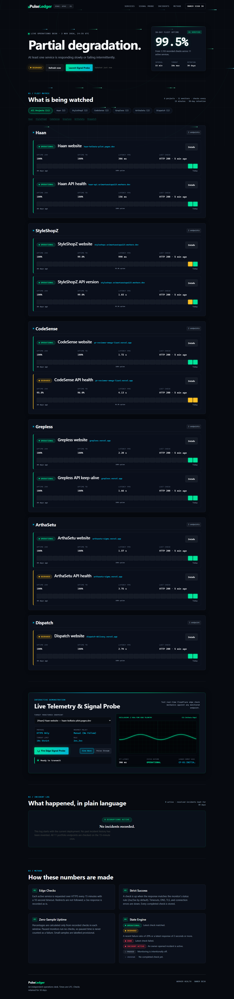
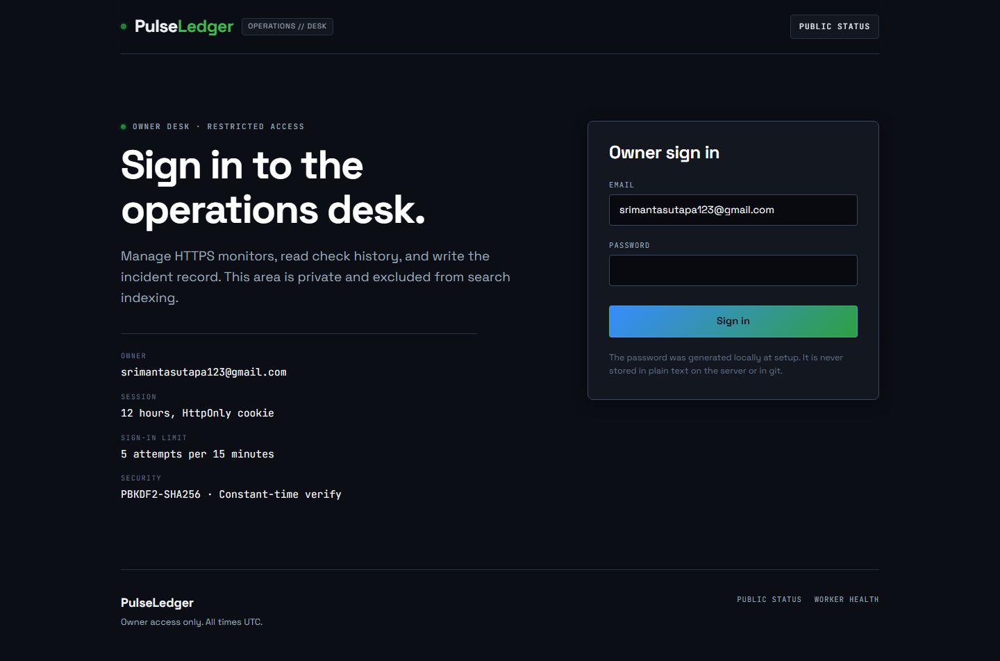
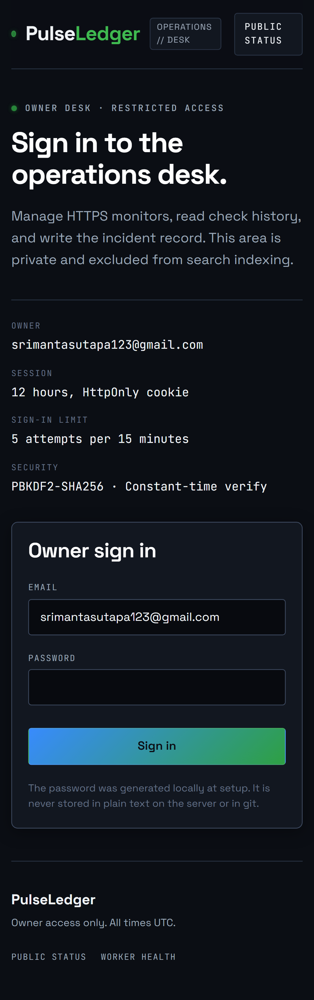
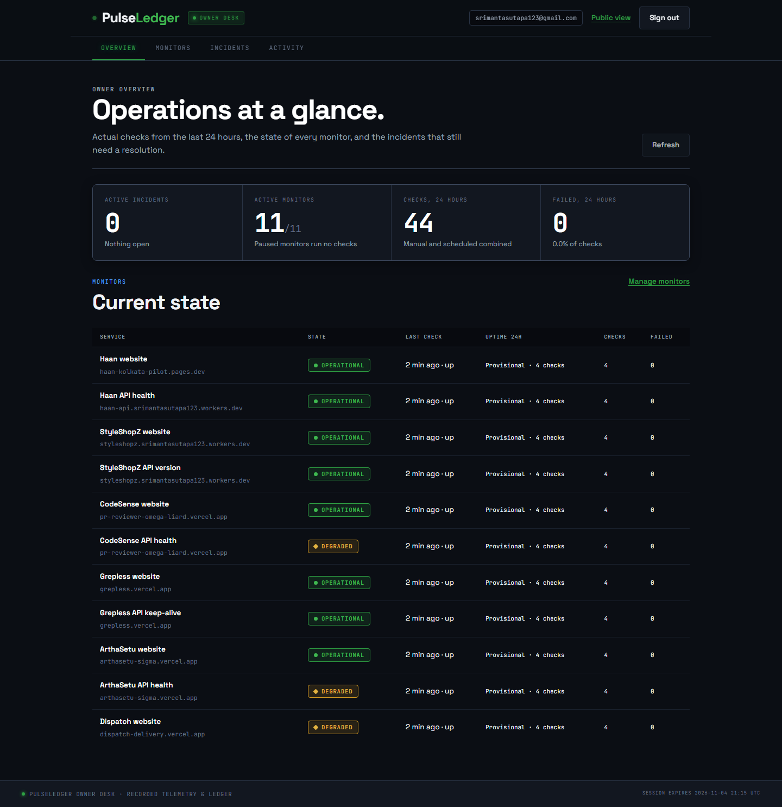
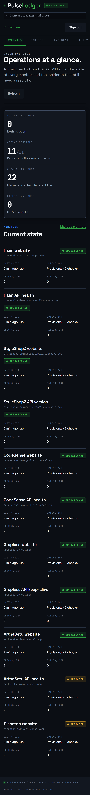
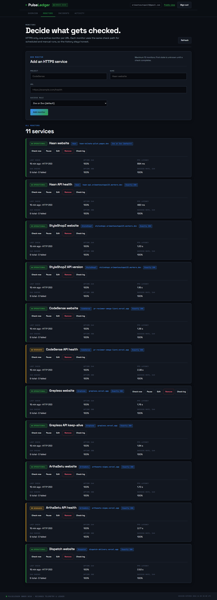

# PulseLedger

An uptime and incident dashboard for independently operated services. A public status
page shows real checks, latency, uptime, and a plain-language incident record. A private
owner desk manages HTTPS monitors, runs checks on demand, and writes incident updates.

**Live:** <https://pulseledger.srimantasutapa123.workers.dev> · **Stack:** Cloudflare
Workers · React 19 + Vite · D1



## What it does

- **Authored Operations Journal Design**: A faithful realization of the Claude-authored reference design (`my-design/home.html`). Dark theme (`--bg: #0c0e0d`, `--acc: #f0a63a`) and Light theme (`--bg: #f3eee2`, `--acc: #9a4400`) with high-contrast tactile craft.
- **Self-Hosted Typography Trio**: Display headlines and brand wordmark in **Instrument Serif** normal 400 (`h1 clamp(52px, 10vw, 160px)`, `h2 clamp(40px, 6.4vw, 100px)`), telemetry metrics and timestamps in **IBM Plex Mono** (400, 500), and interface body copy in **Hanken Grotesk** (400, 500, 600). All fonts are locally vendored and self-hosted as WOFF2 in `public/fonts/`. Legacy admin typography is strictly scoped to `.admin-shell, .login-shell`.
- **Desktop Pinned Check Explorer (`#pipe`)**: GSAP `matchMedia('(min-width: 861px)')` pin `+=2200` driving `pipe(progress)` (draws 629px SVG latency chronograph, sweeps playhead carriage 0%..100%, and sequentially illuminates stages 01–04) with responsive wrap gutters. Phone flows naturally with stacked cards and immediate touch access.
- **Truthful Fleet Health Claims**: Dynamic `deriveStatusClaim(data, error)` truthfully reflects snapshot health and exact per-state counts (`Partial degradation · 4 degraded, 7 operational`, `Major outage`, `System status unavailable`), eliminating hardcoded false all-green claims.
- **Accessible Mobile Touch Navigation**: Compact touch drawer menu (`.mobile-menu-panel`) with $\ge 44\text{px} \times 44\text{px}$ touch targets, document-level `Escape` key handling, and direct links to sections, projects (`#project-haan`, etc.), and `/admin`.
- **4 Scroll-Driven Chapters**: Physical scroll choreography driven by `window.scrollY` and `IntersectionObserver`: (1) `#services` fleet matrix with interactive 30-day ledger strips; (2) `#probe` recorded check explorer replaying genuine Cloudflare D1 checks with illustrative waveforms; (3) `#incidents` scroll-driven rotary verification seal SVG and forensic broadsheet; and (4) `#method` scroll-wired 4-stage operational protocol bus.
- **Dual Living Canvas Engines**: Living background canvas rendering an ambient dust particle field (`canvas#bg`) and a continuous dual-stylus seismograph drum plate (`canvas#tele`) with millimetric chart paper rules, plus a continuous marquee velocity ribbon (`.mq`).
- **Real Edge Checks**: Checks 11 endpoints across Haan, StyleShopZ, CodeSense, Grepless, ArthaSetu, and Dispatch every 15 minutes with real HTTPS requests.
- **Zero-Inventory Truth & D1 Read Budget**: Computes uptime and latency exclusively from stored Cloudflare D1 checks served from a single persisted snapshot row with 5-minute UI refresh and 15-minute cron. Zero synthetic backfills, zero invented statistics.
- **Private Owner Desk**: Restrained operational console for monitor CRUD, pause/resume, manual checks, check logs, incident updates, and activity audit trail.
- **Strict Security Boundaries**: PBKDF2-SHA256 password verification, HttpOnly SameSite=Strict cookies, HMAC CSRF tokens, strict origin verification, and SQL prepared statements.

## Interface Gallery

| View | Desktop (1440px) | Mobile (390px) |
| --- | --- | --- |
| **Public Status Page** |  |  |
| **Owner Sign-In Console** |  |  |
| **Owner Overview Desk** |  |  |
| **Monitors Manager** |  |  |

## Architecture

```text
                    Cloudflare Worker (single origin)
┌──────────────────────────────────────────────────────────────────┐
│  GET /                     Workers Static Assets (React SPA)      │
│  GET /admin                same SPA, owner routes                 │
│  GET /api/status           public status payload                  │
│  GET /health               Worker + D1 health                     │
│  /api/admin/*              session + CSRF + origin protected      │
│  cron */15 * * * *         scheduled handler -> checks.ts         │
└───────────────┬──────────────────────────────┬───────────────────┘
                │                              │
        ┌───────▼────────┐             ┌───────▼────────┐
        │ D1 database    │             │ HTTPS monitors │
        │ monitors       │             │ 6 projects     │
        │ checks         │             │ 11 endpoints   │
        │ incidents      │             └────────────────┘
        │ sessions       │
        │ audit_log      │
        │ cron_runs      │
        └────────────────┘
```

One Worker serves the SPA, API, and cron handler. There is no separate backend, no
external API key, and no third-party analytics.

### Check semantics

- HTTPS only. URLs with credentials, local/private IPs, `localhost`, and non-HTTPS
  schemes are rejected server-side.
- `fetch` uses `redirect: "manual"` and a 10-second timeout. A 2xx/3xx response counts as
  up by default; each monitor can require `200`, `2xx`, `3xx`, or `2xx_3xx`.
- Every completed check stores timestamp, HTTP status or network error category, duration,
  outcome, and source (`scheduled` or `manual`).
- Scheduled checks dedupe by 15-minute slot, so retries and overlaps do not double-count.
- Checks are retained for 30 days. Sessions expire after 12 hours. Audit entries are
  retained for 180 days. Resolved incidents remain in D1 but leave the public log after
  30 days.
- Maximum 12 monitors, documented and enforced server-side; one slot is free for another endpoint.

### Security

- Owner password is generated locally (`scripts/setup-local.mjs`) and stored only as a
  PBKDF2-SHA256 hash (100,000 iterations, the Workers WebCrypto maximum) in the
  `ADMIN_PASSWORD_HASH` Worker secret.
  The plaintext lives only in the gitignored `secrets/owner-credentials.txt`.
- Server-side sessions in D1; only SHA-256 hashes of session tokens are stored. Cookies
  are `HttpOnly`, `SameSite=Strict`, `Secure`, and scoped to `/`.
- CSRF token derived with HMAC from the session token, required on every mutating admin
  request. Origin and `Sec-Fetch-Site` checks reject cross-site writes.
- Login is rate-limited in D1: five failures per 15 minutes per client key.
- Prepared SQL throughout, strict same-origin CORS, CSP, HSTS, `X-Frame-Options: DENY`,
  `nosniff`, and a restrictive permissions policy.
- `/admin` is marked `noindex, nofollow`.

## Repository layout

```text
src/worker/       Worker entry, API, auth, checks, aggregation, validation
src/shared/       Types, status math, uptime windows, URL safety
src/client/       React public page and owner desk
migrations/       D1 schema, indexes, and seeded monitors
tests/            Vitest unit and Worker integration tests
e2e/              Playwright desktop and mobile flows
scripts/          Local setup, database reset, E2E cleanup, secret scan
```

## Local development

Requires Node.js 20+ and npm. A Cloudflare account is not required for local runs.

```bash
npm install
npm run setup:local          # writes .dev.vars and secrets/owner-credentials.txt
npm run db:reset:local       # applies migrations to local D1
npm run build
npx wrangler dev --port 8787
```

Open <http://127.0.0.1:8787>. The owner desk is at `/admin`; read the generated email and
password from `secrets/owner-credentials.txt` (never commit or paste that file).

Local scheduled runs are not automatic. Trigger the real handler with:

```bash
curl http://127.0.0.1:8787/cdn-cgi/local/scheduled
```

Then reload the public page or call `/api/status` to see the stored checks.

### Configuration

| Name | Where | Purpose |
| --- | --- | --- |
| `OWNER_EMAIL` | `wrangler.jsonc` vars | Single owner login |
| `ADMIN_PASSWORD_HASH` | Worker secret / `.dev.vars` | PBKDF2 password hash |
| `ENVIRONMENT` | vars | `development` or `production` |
| `DB` | D1 binding | Monitors, checks, incidents, sessions, audit |
| `ASSETS` | Static Assets binding | Built SPA |

`.dev.vars.example` documents the local shape without containing a real secret.

## Tests and verification

```bash
npm run typecheck            # app, worker, tests, and Node configs
npm test                     # 73 Vitest tests + D1 read budget migration check
npm run build                # production bundle
npm run test:e2e             # Playwright test suites
npm run check:secrets        # scans tracked files and verifies ignores
npm audit --audit-level=high
```

### Playwright E2E & Reference Fidelity

The Playwright testing suite is divided into two focused layers:

1. **Core Functional, Motion, Typography & Navigation Suite** (`e2e/public.spec.ts`):
   ```bash
   npx playwright test e2e/public.spec.ts
   ```
   Runs 20 automated tests across desktop (1440×900) and mobile (390×844) viewports. It is 100% self-contained and executes on any clean checkout without requiring any private reference files. Verifies real checks, uptime history, on-demand refresh, keyboard accessibility, 320px/390px/1440px overflow freedom, anchor clearance under the sticky header, dynamic truthful status claims (`deriveStatusClaim`), mobile touch drawer navigation ($\ge 44\text{px}$ targets, `Escape` key handling), two-position scroll choreography deltas across all four chapters, and computed typography (Instrument Serif 400 `h1` and `h2`, Hanken Grotesk body, and IBM Plex Mono telemetry).

2. **Side-by-Side Reference Fidelity Comparison** (`e2e/fidelity-side-by-side.spec.ts`):
   ```bash
   # Run against authored reference design (if available)
   npx playwright test e2e/fidelity-side-by-side.spec.ts

   # Configure custom reference file path:
   FIDELITY_REFERENCE_PATH=/path/to/home.html npx playwright test e2e/fidelity-side-by-side.spec.ts

   # Explicitly skip reference comparison:
   SKIP_FIDELITY_REFERENCE=true npx playwright test e2e/fidelity-side-by-side.spec.ts
   ```
   Compares the live implementation against the authored Claude design (`my-design/home-working.html` or `my-design/home.html`) across matched before/mid/after scene phases for Chapters 1–4 across viewports (1440, 1024, 390, 320) and themes (dark, light), generating side-by-side screenshots in `docs/motion-review/`.
   **Clean Checkout / Missing Reference Handling**: On a clean checkout where the private design files are not present, this test honestly skips (`2 skipped`) with the explicit reason:
   `Reference design file not found (clean checkout without ignored my-design/home-working.html or my-design/home.html). Set FIDELITY_REFERENCE_PATH or supply reference file to enable side-by-side fidelity comparison.`
   It never marks an unavailable fidelity comparison PASS and never substitutes implementation as reference.

Current results: typecheck clean, 73/73 Vitest tests passing, local D1 migration checks passing, production build succeeds, 20/20 public Playwright tests passing, 2/2 fidelity tests passing (or honestly skipped when reference is omitted), `npm audit` reports 0 vulnerabilities, and the secret scan passes on every tracked file.

Live verification on 2026-11-01: the deployed cron fired in the 08:15 UTC slot and both
seeded monitors recorded `scheduled` checks with HTTP 200 (59 ms and 61 ms). The live
owner desk was exercised end to end with Playwright — monitor create/manual check/edit/
pause/resume/remove with confirmation, plus an incident opened, updated, and resolved and
read back on the public page — and every test-created row was deleted from the remote
database afterward. The live public page has been audited at 1440×900 and 390×844 with no
horizontal overflow.

Portfolio expansion verification on 2026-11-01: remote D1 migration added nine
endpoints and the live owner desk completed manual checks for each one. Two initial
StyleShopZ checks returned 404 only from Worker-to-Worker requests; Cloudflare's
`global_fetch_strictly_public` compatibility flag corrected the route, and both
endpoints then returned HTTP 200 from PulseLedger. The failed checks remain in the
real history, so StyleShopZ may temporarily appear degraded. Dispatch returned HTTP
200 but its roughly six-second response crossed the configured slow threshold.
The 13:45 UTC scheduled slot recorded all eleven endpoints as up with HTTP 200.
The dashboard preserves the later manual failures and slow responses in its history.

## Deployment

1. Authenticate Wrangler and create the D1 database:

   ```bash
   npx wrangler login
   npx wrangler d1 create pulseledger-db
   ```

2. Put the returned `database_id` into `wrangler.jsonc`.

3. Apply migrations and upload the password hash as a secret. Do not paste the hash into
   a tracked file or a shell history you intend to share.

   ```bash
   npm run db:migrate:remote
   npx wrangler secret put ADMIN_PASSWORD_HASH
   ```

4. Deploy:

   ```bash
   npm run deploy
   ```

5. Confirm `https://<worker>.workers.dev/health` returns `{"status":"ok"}`, wait for the
   next 15-minute cron, and confirm the seeded monitors have fresh checks in
   `/api/status`. The scheduled trigger can also be inspected with `npx wrangler tail`.

6. Sign in at `/admin` with the generated owner credentials, run one manual check, and
   verify the public page reflects it. Remove any temporary records afterward.

## Limitations

- Single owner account; there is no team or role model.
- Cloudflare Workers Free plan limits and D1 row limits apply. The twelve-monitor cap and
  30-day check retention keep usage bounded.
- Checks originate from Cloudflare's network only. They are not independent
  multi-region probes and cannot detect a problem isolated to one user's network.
- No email, SMS, or webhook alerting. Failures are visible on the dashboard and incident
  log, not pushed to the owner.
- Redirects are intentionally not followed; a 3xx is evaluated as the final response.
- Resolved incidents older than 30 days leave the public log; incident rows are retained
  in D1 unless manually cleaned.
- Manual checks are synchronous and share the same 10-second timeout as scheduled checks.
- An HTTP 200 on a page or health endpoint does not verify sign-in, checkout, AI review,
  database operations, or other private product flows. PulseLedger observes only its
  configured public URLs. The CodeSense demo repository is separate from the deployed
  CodeSense review service checked here.

## License

MIT. See [LICENSE](LICENSE).
